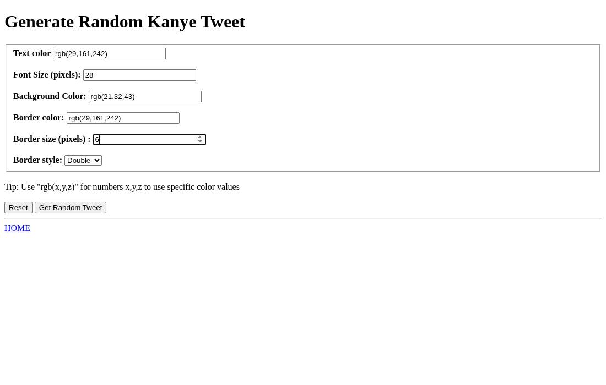
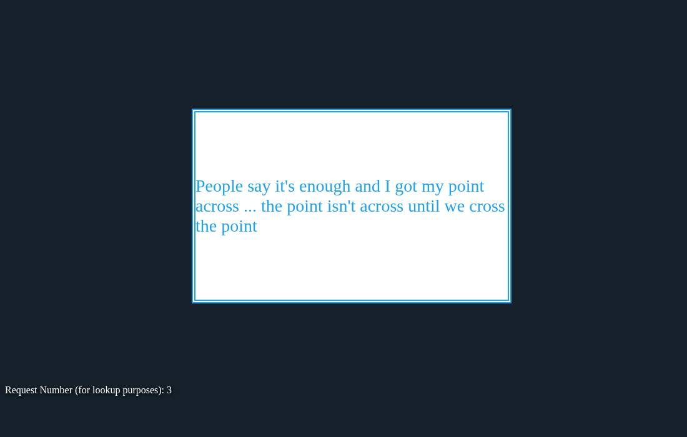
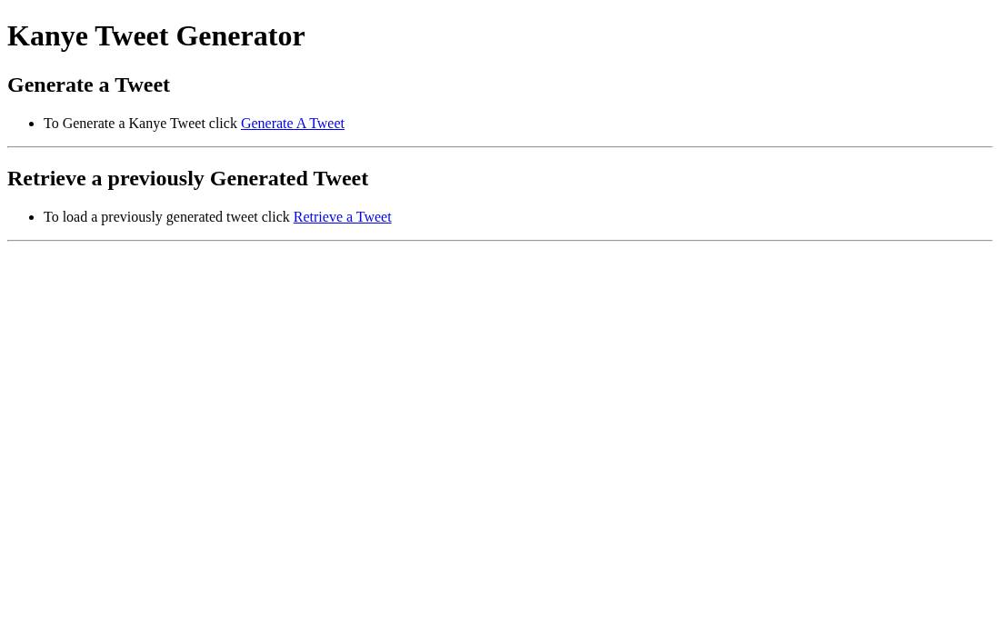
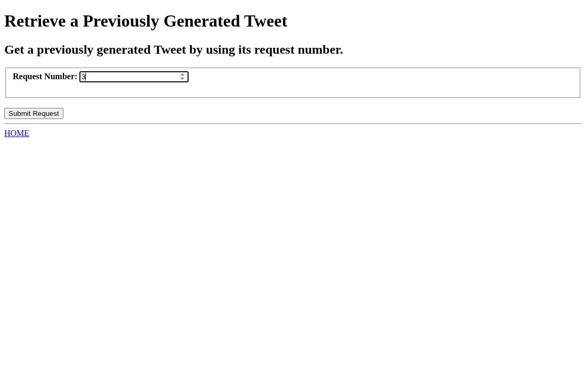

# Kanye Tweet Generator

A college project I built for CMSC 335 in December 2022 ([demo video](https://www.youtube.com/watch?v=AT11ElAXS54)). It's a small Node/Express app that pulls a random Kanye West quote from [kanye.rest](https://kanye.rest/) and shows it styled like a tweet, with the text color, font size, background, and border chosen by the user.

## What it does

- **Generate** (`/generate`): pick the colors (any CSS color, e.g. `rgb(29,161,242)`), font size, and border size/style, then get a random Kanye quote styled your way.
- **Retrieve** (`/retrieve`): every generated tweet is saved to MongoDB with a request number, so you can look it up again later by that number.

## Screenshots

| Generate form | Generated tweet |
| --- | --- |
|  |  |

| Home | Retrieve form |
| --- | --- |
|  |  |

## Running it locally

You need Node.js 18+ and a MongoDB database (a free MongoDB Atlas cluster or a local `mongod` both work).

```sh
npm install
cp .env.example .env   # then fill in the values
npm start              # http://localhost:3000 (or $PORT)
```

`.env` variables:

| Variable | Example |
| --- | --- |
| `MONGO_DB_URI` | `mongodb+srv://<user>:<password>@<cluster>.mongodb.net/` or `mongodb://127.0.0.1:27017/` |
| `MONGO_DB_NAME` | `kanyeTweetGenerator` |
| `MONGO_COLLECTION` | `tweets` |

## Credits

Quotes come from [kanye.rest](https://kanye.rest/), a free REST API for random Kanye West quotes. Built by Sixtus Ijoma.
